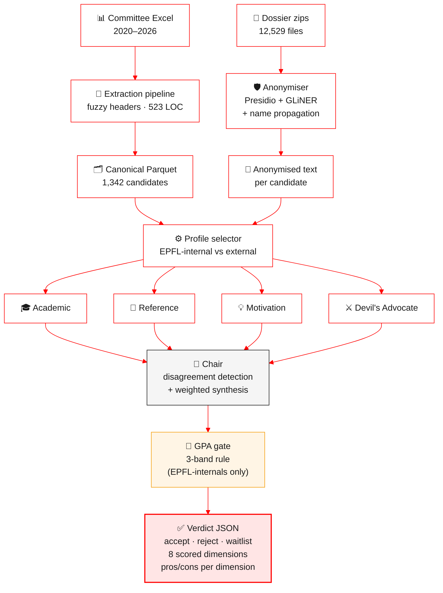

<div align="center">

# Agentic Admission

**A multi-agent LLM panel for MTE dossier evaluation at EPFL**

*Semester project · Spring 2026 · College of Management of Technology*

[](https://www.python.org/downloads/release/python-3130/)
[](#-engineering)
[](#-engineering)
[](https://github.com/astral-sh/ruff)
[](https://github.com/astral-sh/ty)
[](LICENSE)
[](reports/final_report.pdf)

</div>

> A decision-support system that emulates the EPFL **Master in Management, Technology and Entrepreneurship (MTE)** admission committee using a panel of four specialist LLM evaluators and a Chair. Calibrated against six years of historical committee verdicts (1,342 candidates, 2020–2026). Reaches **82% agreement with the committee on the 28 EPFL-internal candidates** of Spring 2025–26 after a documented three-band GPA rule, with a 5-run majority-vote stability of **76.6%** on the full 128-candidate cohort.

---

## Table of contents

1. [The research question](#-the-research-question)
2. [How we got here](#-how-we-got-here-from-question-to-system)
3. [System architecture](#-system-architecture)
4. [Results](#-results)
5. [Quickstart](#-quickstart)
6. [Repository layout](#-repository-layout)
7. [Engineering](#-engineering)
8. [Reports & artefacts](#-reports--artefacts)
9. [Limitations & future work](#-limitations--future-work)
10. [Acknowledgements](#-acknowledgements)
11. [Citation](#-citation)
12. [License](#-license)

---

## 🎯 The research question

Every semester the MTE admission committee at EPFL receives ~130 applications in the spring round and another ~100+ in autumn. A dossier is a heterogeneous package: an academic transcript on whatever scale the home institution uses (US 4.0, French 20, Swiss 6, German 1.0–6.0), two recommendation letters, a motivation letter, a CV, English-proficiency scores, and a stack of certificates. Committee members read all of this and meet for two afternoons to deliver an accept / reject / waitlist verdict.

The bottleneck is **the reading, not the decision**. At 20–30 minutes per dossier and 130 dossiers per round, two committee members reading every file is 80–130 hours of work crammed against a hard deadline. Cases at the boundary get less time than they need; clear-accept and clear-reject cases get more time than they need. The committee has asked for several years whether a triage layer could pre-classify dossiers and surface only the borderline ones for full discussion.

> **Can a multi-agent panel of large language models, calibrated against the historical decisions of a real admission committee, reach an agreement level on a held-out cohort that makes the system useful as a triage tool without introducing systematic bias?**

Three sub-questions sit underneath:

| Sub-question | What it forces us to design |
|---|---|
| **Calibration** — how to measure agreement when ground truth is itself a noisy panel of humans | A measure-and-close loop; a falsification protocol; an explicit ceiling argument |
| **Stability** — LLMs are stochastic, how much does the same dossier move from run to run | A 5-run majority-vote aggregator; per-dimension stdev tracking |
| **Auditability** — the committee will not adopt a system whose decisions cannot be challenged | Structured outputs; per-dimension pros/cons; visible disagreement between specialists |

The system **does not decide**. The committee still decides. The system reads every dossier, scores it on eight dimensions, recommends a verdict, and records its reasoning in a form the committee can audit.

---

## 🧭 How we got here: from question to system

This is a research project first. The system is the answer; the path is the contribution. Each step in the table below corresponds to a weekly report in [`reports/semaine-XX.typ`](reports/) and to a design document in [`docs/plans/`](docs/plans/).

| Stage | What we did | What we learned | Where it lives |
|---|---|---|---|
| **1. Survey** | Read the LLM-as-judge literature (MT-Bench, AlpacaEval, JudgeBench). Walked through past committee decisions with the supervisor. | Zero-shot LLM judgement drifts in domain-specific ways; we will need a calibration loop. | [`reports/semaine-01.typ`](reports/) |
| **2. Data archaeology** | Took six years of inconsistent committee Excel exports (2020–2026), normalised them into a single Parquet of 1,342 candidates. | Schema drifts every year; fuzzy header matching and multi-row grouping are necessary. | [`extraction/pipeline.py`](src/agentic_admission/extraction/pipeline.py) (523 LOC) |
| **3. Anonymisation** | Cleaned 12,529 dossier documents (transcripts, letters, CVs, certificates) with Presidio + GLiNER. Audited a 900-file stratified sample. | A custom name-propagation step is needed to catch ALL-CAPS names that GLiNER misses; passport pages need to be stripped before text extraction. | [`anonymizer/`](src/agentic_admission/anonymizer/) ([`anonymization-audit.pdf`](reports/anonymization-audit.pdf)) |
| **4. Architecture** | Designed a four-evaluator + Chair panel under structured JSON outputs. Spec-first in [`docs/plans/multi-agent-deliberation-design.md`](docs/plans/). | Specialist separation gives audit handles: when system disagrees with committee, you can read four scorecards side-by-side. | [`agents/`](src/agentic_admission/agents/) |
| **5. First calibration** | Ran on Spring 2025–26, measured 50% agreement on EPFL-internals. | We need a falsification event, not a tuning loop. | [`reports/committee-vs-system-2026-05-11.md`](reports/) |
| **6. The Maillard case** | Five of eight EPFL-internal rejects had algebra+analysis avg in [4.0, 4.5]. The committee admitted them on the **recovery trajectory** that a binary threshold cannot see. | The system's rule was simpler than the committee's. Email Géraldine (former chair). | [`docs/plans/epfl-internal-branch.md`](docs/plans/) |
| **7. The three-band rule** | Géraldine (2026-05-19) gave the documented practice: `≥4.5` accept, `4.0–4.5` discuss, `<4.0` reject. Plumbed `EpflInternalBand` through extraction → Chair. | EPFL-internal agreement jumped from 68% → **82%** (+14pp) on the same 28 candidates after PR #23. | [`agents/gpa_gate.py`](src/agentic_admission/agents/gpa_gate.py) |
| **8. Final measurement** | Re-ran the full pipeline. 519 tests, 57.7% line coverage, zero `ty` errors, ruff `ALL` clean. | The engineering posture is what made the academic claims falsifiable. | [`reports/final_report.pdf`](reports/final_report.pdf) |

The full 14-week journey is documented as weekly reports ([`semaine-01.typ`](reports/semaine-01.typ) through [`semaine-14.typ`](reports/semaine-14.typ)).

---

## 🏗️ System architecture



### The four evaluators

Each evaluator is one LLM call with a role-specific system prompt and a JSON-schema response model. The four roles cover orthogonal evidence types:

| Role | Scores | Reads |
|---|---|---|
| **Academic** | `academic_strength`, `institution_quality` | Transcript, GPA, institution category (A/B/C/X), SPE threshold |
| **Reference** | `reference_quality`, `calibration_confidence` | 2–3 recommendation letters + cultural-calibration profile |
| **Motivation** | `motivation_clarity`, `program_fit` | Motivation letter, CV, work history |
| **Devil's Advocate** | `risk_flags`, `consistency` | Full dossier — cross-document check |

### The Chair

One LLM call (`agents/chair.py`, 705 LOC) does two jobs: **(1)** detect semantic disagreement between the four scorecards (a score gap is not a disagreement — a disagreement is when two evaluators interpret the same evidence differently); **(2)** synthesise a final 8-dimension scorecard, compute the weighted composite, and emit `accept / reject / waitlist` with structured pros and cons.

### Profiles & weights

Two profiles ship out of the box, defined as immutable dataclasses with weights validated to sum to 1.0 (`agents/evaluation_profile.py`):

| Dimension | External | EPFL-internal |
|---|:---:|:---:|
| `academic_strength`     | 0.30 | 0.45 |
| `institution_quality`   | 0.18 | 0.10 |
| `reference_quality`     | 0.18 | 0.00 |
| `calibration_confidence`| 0.12 | 0.00 |
| `motivation_clarity`    | 0.06 | 0.15 |
| `program_fit`           | 0.06 | 0.15 |
| `risk_flags`            | 0.05 | 0.075 |
| `consistency`           | 0.05 | 0.075 |
| **Sum**                 | **1.00** | **1.00** |

EPFL-internals don't submit reference letters in 4 of 5 sampled dossiers — the reference weights drop to zero and the mass redistributes to academic, motivation, and fit. The institution weight also drops because the institution is always EPFL and carries no signal.

### Decision logic

| Composite range | Decision (default floors) |
|---|---|
| `composite ≥ 8.0` | `accept` |
| `7.0 ≤ composite < 8.0` | `waitlist` |
| `composite < 7.0` | `reject` |

A second decision layer sits on top: the **GPA gate**, which only fires for EPFL-internal candidates and implements the three-band rule (≥4.5 / [4.0, 4.5) / <4.0 on algebra+analysis average).

---

## 📊 Results

<table>
<tr>
<td align="center" width="33%">

### EPFL-internal agreement
# **82%**
23 / 28 after PR #23
(up from 50% baseline; +14pp from previous best)

</td>
<td align="center" width="33%">

### Decision stability
# **76.6%**
98 / 128 same decision<br/>across 5 independent runs

</td>
<td align="center" width="33%">

### Anonymisation coverage
# **100%**
emails · phones · addresses<br/>AVS · IBAN · URLs

</td>
</tr>
</table>

### EPFL-internal sub-cohort — three weeks of measurement

| Run | Accept | Reject | Waitlist | Agreement / 28 |
|---|:---:|:---:|:---:|:---:|
| Committee | 27 | 1 | 0 | reference |
| Week 12 baseline                         | 13 | 8 | 7 | 14 / 28 (50%) |
| Week 13 fix 1 (single-rule)              | 15 | 7 | 6 | 15 / 28 (54%) |
| Week 13 fix 2 (prompt re-write)          | 19 | 4 | 5 | 19 / 28 (68%) |
| **Week 14 PR #23 (band rule + code)**    | **23** | **1** | **4** | **23 / 28 (82%)** |

Each row is a measured before/after on the **same 28 candidates**. The week-14 number is a single run after the band rule shipped; the next step is a 5-run majority-vote re-measurement.

### Confusion matrix on the full Spring 2025–26 cohort (5-run majority vote)

|                | System: accept | System: waitlist | System: reject | Total |
|---|:---:|:---:|:---:|:---:|
| **Committee: accept** | **34** | 6 | 1 | 41 |
| **Committee: reject** | 20 | 46 | **20** | 86 |

Strict agreement = 54 / 127 = **42.5%**. The 46 cases where the committee rejected and the system put on waitlist are not flat misses — they are exactly what triage should do: surface for discussion. Counting waitlist as *agree-with-doubt* the agreement rises to **78.7%**.

### Per-dimension stability (run-to-run stdev, n=128 × 5 runs)

| Most stable → least stable |
|---|

| Dimension | Mean stdev |
|---|:---:|
| `motivation_clarity` | 0.053 |
| `institution_quality` | 0.129 |
| `calibration_confidence` | 0.132 |
| `program_fit` | 0.194 |
| `reference_quality` | 0.248 |
| `academic_strength` | 0.293 |
| `consistency` | 0.380 |
| `risk_flags` | 0.467 |

The composite stdev is **0.175**. We treat `risk_flags` as a tiebreaker (weight 0.05 in external profile) and read the pros/cons text rather than the score in audit.

### Cost per dossier

| Mode | Per dossier | Per cohort (128) | 5-run cohort |
|---|:---:|:---:|:---:|
| Gemini Flash | $0.08 | $10 | $50 |
| Sonnet 4.6 | $0.70 | $90 | $450 |
| Local Llama 3.1 8B on SCITAS | ~$0 (compute only) | ~$0 | ~$0 |

---

## 🚀 Quickstart

### Prerequisites

- **Python 3.13+**
- [**uv**](https://docs.astral.sh/uv/) — package manager and project runner
- [**typst**](https://github.com/typst/typst) — *optional*, only if you want to recompile the report
- An OpenAI-compatible LLM endpoint (vLLM, OpenRouter, local Llama on SCITAS, …)

### Install

```bash
git clone https://github.com/eliemada/agentic-admission.git
cd agentic-admission
uv sync --frozen
uv run poe setup-nlp        # one-time spaCy model download
cp .env.example .env        # then fill in your endpoints / API keys
```

### Reproduce the audit-grade state of the repository

```bash
uv run poe lint             # 700+ ruff rules + ty type check
uv run poe test             # 519 tests, ~100 s, coverage gate at 55%
uv run poe extract          # rebuild data/processed/all_candidates.parquet
```

### Run the pipeline end-to-end

```bash
uv run poe ingest           # ZIP/TAR/dir → staging
uv run poe strip-passports  # record presence, delete passport pages
uv run poe extract-text     # PDF → Markdown via Docling
uv run poe anonymize        # Presidio + GLiNER pipeline
uv run poe evaluate         # multi-agent panel → verdict JSON
```

### Demo: evaluate 5 candidates (2 admitted, 3 rejected)

```bash
uv run poe demo
```

### Launch the Admission Console (dashboard)

```bash
uv run poe dashboard        # API at http://localhost:8000
uv run poe dashboard-dev    # Vite dev server with hot reload
```

### Available poe tasks (`uv run poe --help` for the full list)

| Task | What it does |
|---|---|
| `lint` | All pre-commit hooks (ruff check, ruff format, ty, …) |
| `typecheck` | `ty check src` |
| `test` | pytest with coverage (fails under 55%) |
| `extract` | Excel files → `data/processed/all_candidates.parquet` |
| `eda` / `dossier-eda` | Open Marimo notebooks for exploratory analysis |
| `ingest` | Ingest dossier ZIP/TAR/dir into staging |
| `strip-passports` | Record passport/ID presence; delete the files |
| `extract-text` | PDF → Markdown via Docling |
| `anonymize` | PII anonymisation pipeline |
| `evaluate` | Run the multi-agent admission pipeline |
| `demo` | Demo eval on 5 candidates |
| `calibrate` | Letter ingestion + cultural-profile generation |
| `dashboard` / `dashboard-dev` | Admission Console (API / frontend dev) |
| `build-cohort` | Parse Synthèse PDFs → cohort JSON |
| `scrape-curriculum` | Scrape EPFL curriculum → `data/reference/` |

---

## 📁 Repository layout

```
agentic-admission/
├── src/agentic_admission/        # Library code (~12.3k LOC, ruff ALL clean)
│   ├── extraction/               # Excel → Parquet (fuzzy headers, multi-row grouping)
│   ├── intake/                   # ZIP/TAR scanning, dossier↔candidate matching, triage
│   ├── preprocessing/            # File normalisation, PDF→Markdown via Docling
│   ├── anonymizer/               # Presidio + GLiNER, Swiss-PII recognisers, post-filters
│   ├── models/                   # Pydantic v2 models — Candidate, Dossier, PanelVerdict
│   ├── agents/                   # Multi-agent panel: evaluators, Chair, GPA gate, LLM client
│   ├── calibration/              # Reference-letter retrieval, cultural profiles
│   ├── curriculum/               # EPFL curriculum scraper + bachelor matcher
│   ├── config.py                 # pydantic-settings — .env loader
│   └── main.py                   # Entry point
├── tests/                        # 519 tests, 57.7% line coverage
├── dashboard/                    # FastAPI + React Admission Console
├── scripts/                      # One-shot analysis & before/after diffs
├── slurm/                        # SCITAS HPC job scripts
├── docs/
│   ├── plans/                    # 8 spec-first design documents
│   └── unofficial-guidelines.md  # Reverse-engineered committee rules
├── reports/
│   ├── final_report.{typ,pdf}    # Final project report (this PDF)
│   ├── references.bib            # Report bibliography
│   ├── anonymization-audit.{typ,pdf} # 900-file stratified audit
│   ├── architecture-design.pdf   # System architecture (one-pager)
│   ├── semaine-{01..14}.{typ,pdf}# 14 weekly reports
│   └── *.md                      # Calibration analyses (committee vs. system)
├── notebooks/                    # Marimo notebooks (eda, dossier_eda, …)
├── data/                         # gitignored — raw Excels + dossier zips
├── .env.example                  # Configuration template
├── pyproject.toml                # uv + poe + ruff + ty + coverage
└── uv.lock                       # 4 MB lockfile, committed for reproducibility
```

---

## 🛠 Engineering

The engineering posture exists in service of the academic claim: **a research contribution that cannot be reproduced is a research contribution that cannot be checked**.

| | Practice |
|---|---|
| **Spec-first** | Every non-trivial change starts as a Markdown design doc in `docs/plans/` (8 docs as of week 14). The doc frames a hypothesis, lists alternatives, fixes the chosen approach, and lists validation criteria. |
| **TDD** | 519 tests with `pytest --exitfirst --failed-first` as default. Warnings treated as errors. CI runs lint, typecheck, and tests on every push. |
| **Lint as a gate** | Ruff with `select = ["ALL"]` (~700 rules) on library code. `per-file-ignores` for one-off scripts. The `ty` type checker is enforced — zero errors. |
| **Atomic PRs** | 23 PRs landed on `main` during the semester; each is self-contained with a green CI. The largest (PR #23: band rule + test cleanup + `llm_client` refactor) is the only multi-concern bundle. |
| **Pre-commit** | Hooks run ruff, ruff-format, `ty`, and `uv lock check` before any commit lands. |
| **Reproducibility** | The pipeline reproduces from a clean checkout in four commands. The lockfile is committed; CI verifies `uv sync --frozen` produces an identical environment. |

### CI

[`.github/workflows/test.yml`](.github/workflows/test.yml) runs **lint → typecheck → test** on every push to `main` and on every PR.

---

## 📚 Reports & artefacts

| Artefact | Description |
|---|---|
| [`reports/final_report.pdf`](reports/final_report.pdf) | **The full project report** — 11 sections, 3 appendices, EPFL formatting |
| [`reports/semaine-01.pdf`](reports/) … [`semaine-14.pdf`](reports/) | 14 weekly reports tracing the path from question to system |
| [`reports/architecture-design.pdf`](reports/) | One-page architectural overview |
| [`reports/anonymization-audit.pdf`](reports/anonymization-audit.pdf) | 900-file stratified audit (50 × 18 doc types, seed 42) |
| [`docs/plans/`](docs/plans/) | 8 spec-first design documents |
| [`reports/committee-vs-system-policy-v2.md`](reports/) | Raw calibration analysis underlying §7 of the final report |
| [`reports/epfl-internal-fix*.md`](reports/) | Before/after diffs for the three EPFL-internal iterations |

---

## ⚠️ Limitations & future work

The system is usable as a triage tool today on the EPFL-internal sub-cohort and as a discussion-surfacer on the broader cohort. **Eight items would close the gap between research prototype and committee-grade decision support** (§8 of the report):

| Priority | Item |
|---|---|
| **High** | 5-run majority vote post-PR #23 on the 28 EPFL-internals (~$50 / 3 h) |
| **High** | Bias audit stratified by gender, nationality, institution category |
| **High** | Sonnet 4.6 vs Gemini Flash comparison on the 20 type-A & 8 borderline cases |
| Medium | Committee dashboard — side-by-side viewer, click-to-expand evaluator debate |
| Medium | Active-learning loop — feed disagreements back as few-shot anchors |
| Medium | Extend validation to Fall 2025–26 cohort (~230 candidates) |
| Low | SCITAS deployment — local Llama 3.1 over HPC, removes API cost |
| Low | Latency for live use — target <10 s end-to-end (currently ~30 s) |

### Known threats to validity

- **Calibration set size** — 128 Spring 2025–26 candidates is small; EPFL-internal sub-cohort tighter (n=28)
- **Single LLM family** — all headline numbers come from one model family
- **Prompt sensitivity** — paragraph-level prompt edits move the agreement number; the 5-run vote dampens this
- **Selection on committee** — the recorded committee decision is itself a point estimate of a noisy panel; any agreement number is bounded above by the (unmeasured) committee self-agreement
- **No bias audit yet** — listed as the highest-priority next step

---

## 🤝 Acknowledgements

- **Prof. Gaétan de Rassenfosse** (supervisor, CDM-MTE)
- **Géraldine**, former MTE committee chair, for the three-band rule (2026-05-19 correspondence)
- **MTE admission committee** for the historical decision corpus and ongoing feedback
- **EPFL SCITAS** for HPC access to vLLM-served local models

This project builds on the open-source work of [Presidio](https://github.com/microsoft/presidio), [GLiNER](https://github.com/urchade/GLiNER), [Docling](https://github.com/DS4SD/docling), [vLLM](https://github.com/vllm-project/vllm), and the Astral toolchain ([`uv`](https://github.com/astral-sh/uv), [`ruff`](https://github.com/astral-sh/ruff), [`ty`](https://github.com/astral-sh/ty)).

---

## 📖 Citation

If you use this work, please cite the final report:

```bibtex
@techreport{bruno2026agenticadmission,
  title       = {Agentic Admission: A multi-agent LLM panel for MTE dossier evaluation at EPFL},
  author      = {Bruno, Elie},
  institution = {{\'E}cole polytechnique f{\'e}d{\'e}rale de Lausanne (EPFL),
                 College of Management of Technology},
  type        = {Semester project},
  year        = {2026},
  month       = {May},
  url         = {https://github.com/eliemada/agentic-admission}
}
```

---

## 📄 License

Released under the [MIT License](LICENSE) — permissive, EPFL-compatible, and standard for academic open-source.

> *No personally identifiable information from real dossiers is included in this repository.* All examples in tests and reports use redacted or synthetic data. The `data/` directory is gitignored and the contents are governed by the MTE programme's internal data-handling policy.

---

<div align="center">

*Built with care for the MTE admission committee at EPFL.*
*Spring 2026.*

</div>
